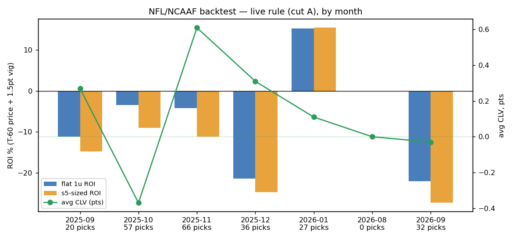
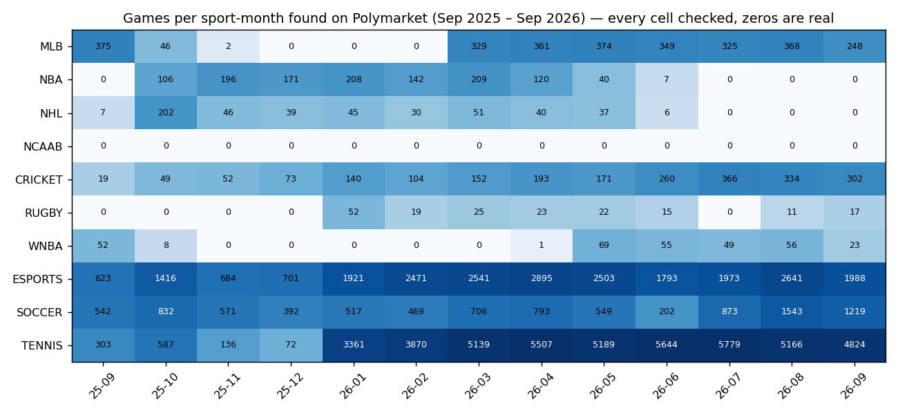
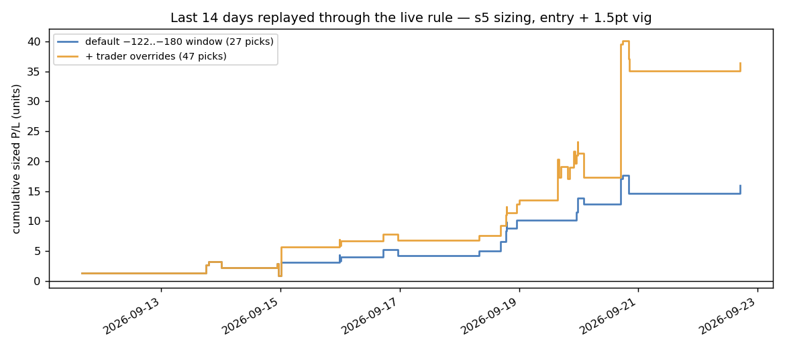
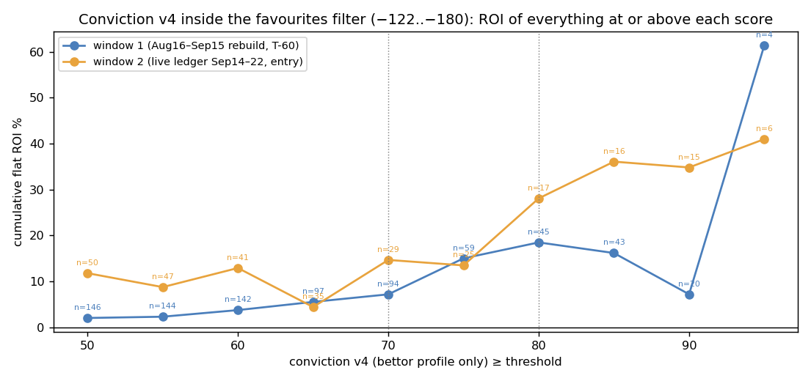
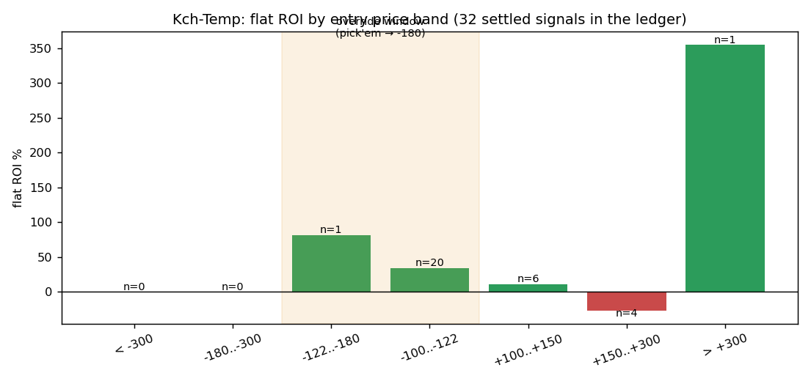

# Results

All ROI figures are graded at a **bettable** price: T-60 price (research
windows) or the sharp's entry (live ledger) **plus 1.5 pts of vig**. Intervals
resample games, not legs. "Cut A" is the live wallet gate (hold ≥ 1.5%, 90-day
realised P/L ≥ $50K, vol ≥ $500K); "picks" are rows scoring ≥ 70 inside
−122..−180 — i.e. what the live system would have published.

## 1. NFL / NCAAF, seven months, genuinely out of sample

Each month discovered its own sharps from that month's trades and gated them
on the 90 days before the window. None of these months played any part in
choosing the rules.

| Month | Games | Wallets | Alerts (≥65) | Picks | Record | Flat ROI | s5 ROI | avg CLV |
|---|---|---|---|---|---|---|---|---|
| Sep 2025 | 247 | 237 | 229 | 20 | 11-9 | −11.1% | −14.8% | +0.27 |
| Oct 2025 | 283 | 394 | 437 | 57 | 33-24 | −3.4% | −9.0% | −0.37 |
| Nov 2025 | 297 | 484 | 674 | 66 | 38-28 | −4.2% | −11.1% | +0.61 |
| Dec 2025 | 93 | 416 | 421 | 36 | 17-19 | −21.4% | −24.7% | +0.31 |
| Jan 2026 | 18 | 401 | 255 | 27 | **19-8** | **+15.2%** | +15.4% | +0.11 |
| Aug 2026 | 9 | 6 | 2 | 0 | — | too thin (preseason) | — | — |
| Sep 2026 | 229 | 266 | 457 | 32 | 15-17 | −22.0% | −27.3% | −0.03 |

**Verdict: no repeatable edge.** Five losing months, one strong win (January —
the playoffs, and only 27 picks), one too thin to score. Inside every month,
the best rule found on the first 60% of games lost on the last 40%
(`strategies.txt` per month). CLV was positive in most months while ROI was
negative — the picked wallets buy before the market moves their way, but the
outcomes don't follow it at these sample sizes. The tighter the wallet gate
(cuts C–E), the *higher* the CLV and the *worse* the ROI in Nov/Dec.

"Alerts" is the answer to *how many plays per month would have qualified for
an alert*: 230–670 in a full football month, ~2 in preseason.

Full tables per month: `results/football/<month>/cuts.txt` (five gate
variants) and `strategies.txt` (four strategy families, in- and
out-of-sample).

## 2. The rest of the year, every sport

`hist_probe_months.py` checked all 10 sports × 13 months (130 cells) — every
zero is a real, logged count, not an assumed off-season. 92 sport-months with
≥ 8 games are being run through the full pipeline; soccer hit gamma's
2,000-event query cap in four months (undercounted, flagged).

Completed so far (the run is sequential and ongoing; see
`results/sports/cross_sport_snapshot.txt` for the dated table):

- **Cricket, 13/13 months:** ~2,500 games, **1 pick in a year** under the live
  rule. Cricket's odds structure barely overlaps −122..−180. Empty, not negative.
- **Esports:** in progress.
- MLB, NBA, NHL, WNBA, rugby, soccer, tennis: queued.

## 3. The live rule replayed on the last 14 days

Every logged signal from the past 14 days pushed through the current
`picks.qualifies()`, sized by s5, graded at entry + vig. **This period overlaps
one of the two build windows and is the same sample the trader overrides were
set from — it is an in-sample ceiling, not a forward result.**

| | Picks | Record | Flat ROI | Sized risk | Sized net | Sized ROI |
|---|---|---|---|---|---|---|
| Default −122..−180 window only | 27 | 20-7 | +22.4% | 46u | +13.6u¹ | +29.9% |
| + trader price overrides (live) | 47 settled | 34-13 (72%) | +24.8% | 104u | +36.4u | +34.9% |

¹ The chart's default-window line ends at +15.9u because the two trusted-name
size steps added on 09-24 (justaluckydude, CandleHammerDrums) apply to their
in-window picks; +13.6u is the figure before those steps.

The override picks (18-6, +40.5% sized) are almost all Kch-Temp's NCAAF/NFL
spreads and totals — the very bets that justified his override. Circular by
construction. One day (Sun Sep 20, 7-1) carries most of it; Sat Sep 19 shows
the other side (5 of the 13 losses, sized 2–3u each).

## 4. Why price is a filter and the score is the bettor

Inside the favourites window, the bettor-only score (v4) orders ROI in both
build windows: everything scoring ≥ 80 returned +18.5% (window 1, n=45) and
+28.1% (window 2, n=17). Outside the window, no bettor feature orders outcomes
— hold tiers, lifetime P/L, size-vs-normal and consensus each flip sign
between the two windows. Conviction v2 (with its ×1.45 underdog multiplier)
was anti-monotone in both: its top quintile returned −21% and −15%.

## 5. Per-trader exceptions

Kch-Temp's own 32 settled signals split sharply by price band: pick'em to −122
is 14-6 (+35%); +150 and longer is 1-3. His override widens the pick window
down to pick'em and no further. justaluckydude (15-0 across every favourite
band) and CandleHammerDrums (12-2 on favourites, 0-2 on dogs) run the opposite
way and get the favourite side widened to −300. Soarin22 (6 signals) and
GrizzliesSuck (10) were checked and declined — too thin. Every override pick is
tagged so its CLV can be judged apart.

## 6. What the live record actually is

`picks.py --record` on 2026-09-24: **12 graded picks, 5-7, −9.2u**, all
published under the earlier score/sizing versions (two of them in-game, since
fixed). The v4/s5/override configuration has published one pick so far
(Packers −4.5, 4u, 2026-09-24). CLV on the three cleanly-priced picks:
−0.93 pts, 0 of 3 beat the close. That is the honest starting line for the
forward record; the target is CLV ≥ 0 over 200 graded picks.
